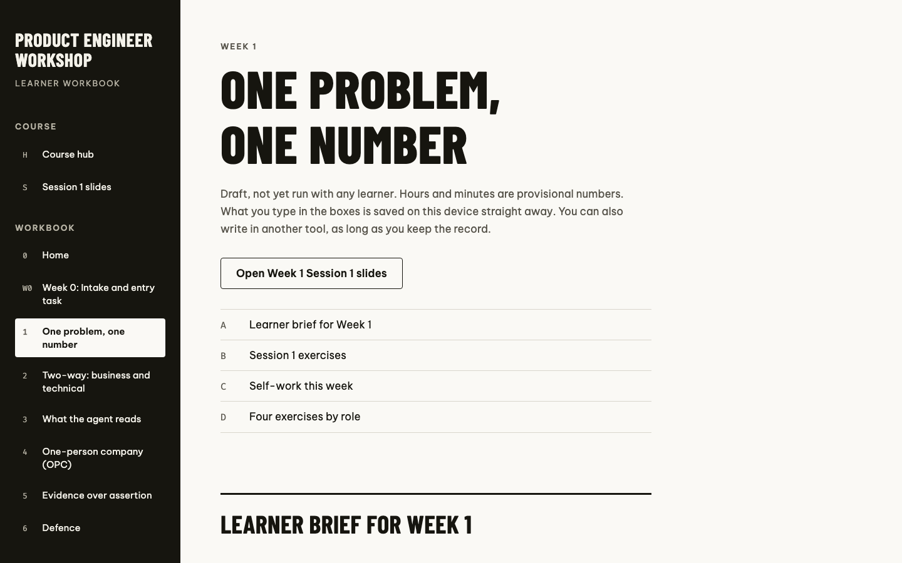
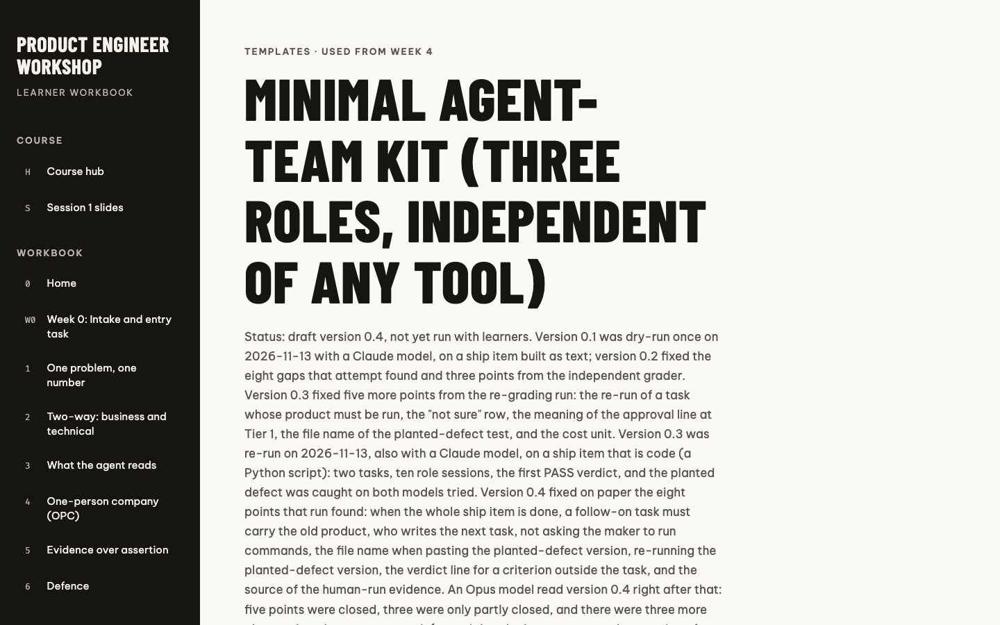

# Ship one measured change into the work you already do in six weeks.

**Product Engineer Workshop** (Six-week cohort, one real ship item)

Six-week Product Engineer cohort for employed developers, designers, and QA: one real ship item, before-and-after numbers, workbook, and slides.


- **Course Hub (GitHub Pages):** https://jangtrinh.github.io/product-engineer-workshop/
- **Learner Workbook:** https://jangtrinh.github.io/product-engineer-workshop/workbook/
- **Session 1 Slide Decks:** https://jangtrinh.github.io/product-engineer-workshop/decks/
- **Week 0 Entry Task:** https://jangtrinh.github.io/product-engineer-workshop/workbook/week-0.html

---

## Course curriculum and learner materials

Every week moves one real ship item forward by one milestone and adds one layer to your agentic system.

| Week | Topic | Ship item milestone | Agentic system added | Workbook | Slides |
| :--- | :--- | :--- | :--- | :--- | :--- |
| W0 | Before Week 1: Entry task | Intake interview preparation, two candidate problems, manager note | None yet | [Week 0 workbook](https://jangtrinh.github.io/product-engineer-workshop/workbook/week-0.html) | Not applicable |
| W1 | One problem, one number | Problem frame; candidate number | Personal working rules | [Week 1 workbook](https://jangtrinh.github.io/product-engineer-workshop/workbook/week-1.html) | [Slides (28)](https://jangtrinh.github.io/product-engineer-workshop/decks/week-1.html) |
| W2 | Two-way: business and technical | Settle the number, start measuring the baseline window; spec with acceptance criteria | Spec as input for the agent | [Week 2 workbook](https://jangtrinh.github.io/product-engineer-workshop/workbook/week-2.html) | [Slides (32)](https://jangtrinh.github.io/product-engineer-workshop/decks/week-2.html) |
| W3 | What the agent reads | Ontology for the work area; first part of the ship item is built | Ontology, first skill, maker agent | [Week 3 workbook](https://jangtrinh.github.io/product-engineer-workshop/workbook/week-3.html) | [Slides (32)](https://jangtrinh.github.io/product-engineer-workshop/decks/week-3.html) |
| W4 | One-person company (OPC) | First version that passes a grader agent against the acceptance criteria | Three-role team: coordinator, maker, grader; self-triggered schedule | [Week 4 workbook](https://jangtrinh.github.io/product-engineer-workshop/workbook/week-4.html) | [Slides (32)](https://jangtrinh.github.io/product-engineer-workshop/decks/week-4.html) |
| W5 | Evidence over assertion | Passes the gate, goes to 1 or 2 colleagues, then ships to real users | Gate that can go red, one routine | [Week 5 workbook](https://jangtrinh.github.io/product-engineer-workshop/workbook/week-5.html) | [Slides (32)](https://jangtrinh.github.io/product-engineer-workshop/decks/week-5.html) |
| W6 | Defence | Ship deadline; oral defence (plus re-measure 2 to 4 weeks later) | Lessons turned into automatic checks | [Week 6 workbook](https://jangtrinh.github.io/product-engineer-workshop/workbook/week-6.html) | [Slides (18)](https://jangtrinh.github.io/product-engineer-workshop/decks/week-6.html) |

### Templates

- [Agent-team kit](https://jangtrinh.github.io/product-engineer-workshop/workbook/agent-team-kit.html): Three separated roles (coordinator, maker, grader), hand-off file format, authority tiers, and planted-defect test. Used from Week 4.
- [Case-study permission letter](https://jangtrinh.github.io/product-engineer-workshop/workbook/case-study-permission.html): Template for requesting manager or legal approval to share a sanitised case study publicly. Used in Week 6.

---

## Course facts register

- **Repository:** [jangtrinh/product-engineer-workshop](https://github.com/jangtrinh/product-engineer-workshop)
- **For whom:** Employed developers, designers, and QA with a real product, internal tool, or workflow to ship into
- **Cadence:** 6 study weeks (2 live 2-hour sessions plus provisional self-work per week) plus 1 re-measure defence 2 to 4 weeks later; max 5 learners per cohort
- **Core method:** First Principles Loop plus four pillars (two-way thinking, ontology engineering, OPC management, multi-agent team)
- **Telemetry and data:** Zero tracking; workbook inputs stay in local browser `localStorage` and export as Markdown
- **License:** Source-available under PolyForm Shield 1.0.0 (free to use for learning and work; no resale or competing course)

---

## How learners work each week

1. **Complete the Week 0 entry task and manager note.** Prepare two candidate problems from your current work with three downward Whys (no AI), then send the manager note in [Week 0 workbook](https://jangtrinh.github.io/product-engineer-workshop/workbook/week-0.html) so your workplace scope is clear before Session 1.
2. **Run Session 1 paper-first, then challenge AI drafts.** Spend the opening 20 minutes breaking down and rebuilding on paper without AI, compare your facts against the model and worked examples, and apply the concept to your ship item with any AI tool your company permits.
3. **Measure numbers, build the 3-role kit, and defend evidence.** Track baseline and after windows on your ship item, run the three-role system in [Agent-team kit](https://jangtrinh.github.io/product-engineer-workshop/workbook/agent-team-kit.html) from Week 4, and defend raw logs and live checks in Session 2 peer grading and the post-course re-measure.

---

## Method, four pillars, and scope boundaries

### First Principles Loop

1. **Frame.** State the problem in one sentence, with an observable success test.
2. **Break down.** Ask why repeatedly and use the six types of Socratic question until you reach what cannot be broken down further, separating certain facts from assumptions.
3. **Ask what would make this unnecessary.** If there is an answer, the problem has changed.
4. **Rebuild.** Build the solution only from what is certain, then invert: how could this solution fail.
5. **Predict, then test.** Write down the prediction before you act, and run the cheapest test that could disprove it.

### Four content pillars

- **Two-way product thinking.** Walk down from business goal to technical decision and back up through measured baseline and after numbers.
- **Ontology engineering.** Define the things, named relations, and source of truth an agent reads before acting.
- **Management for running agentic AI.** Apply unit economics, information stewardship, authority tiers, and internal control gates to your own workflow.
- **Build your own agentic system.** Add working rules, spec, ontology and skill, three-role separation, red-to-green gates, and automatic checks step by step.

### What this workshop is not (draft curriculum status)

This is a draft curriculum that has not yet been run with learners; all weekly self-work hour estimates and provisional timings will be recalibrated after the first cohort.

- It does not teach entry-level coding, design, or QA craft from scratch.
- It is not a prompt-tips collection or a tour of AI tools.
- It does not teach entrepreneurship, raising funding, or starting a company.
- It does not grant certificates without a shipped change backed by before-and-after numbers.

---

## Inside the learner workspace

### Interactive Learner Workbook

Covers Week 0 through Week 6 with role exercises, copyable Markdown sheets, and automatic local browser storage.



### Session 1 Web Slide Decks

Six interactive 16:9 concept decks (174 slides total) with keyboard controls, slide grid overview, and sequential PDF print support.


### Tool-Agnostic Agent-Team Kit

Three separated roles (coordinator, maker, grader), Markdown hand-off formats, approval tiers, and a planted-defect verification test.



---

## Local offline preview

```bash
python3 -m http.server 4403 --bind 127.0.0.1 --directory docs
```

Then open `http://127.0.0.1:4403/` in your browser.

---

## License

This repository is **source-available** under the [PolyForm Shield License 1.0.0](LICENSE) (Copyright 2026 Jang Trinh). You may read, learn from, and use the workbook, slide decks, and agent-team kit in your own work for any permitted purpose, except providing any competing course or commercial product.
