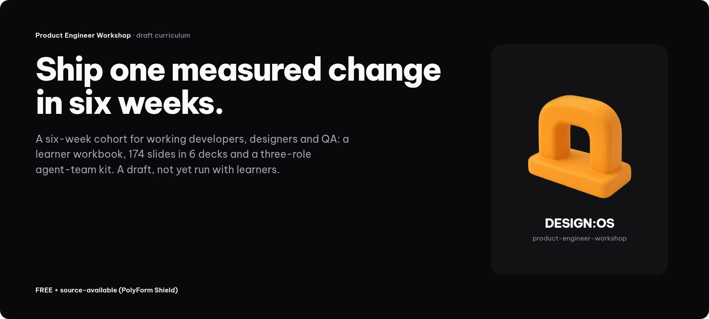
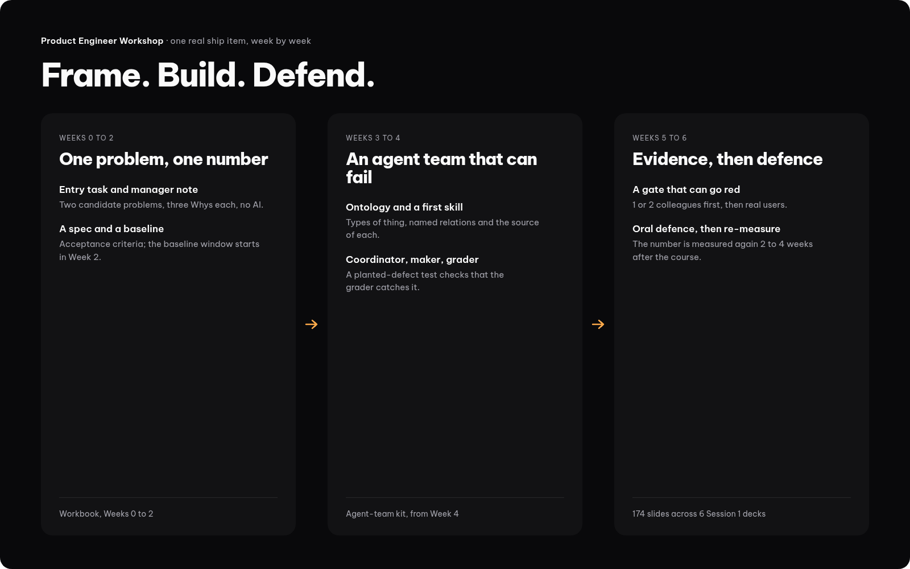
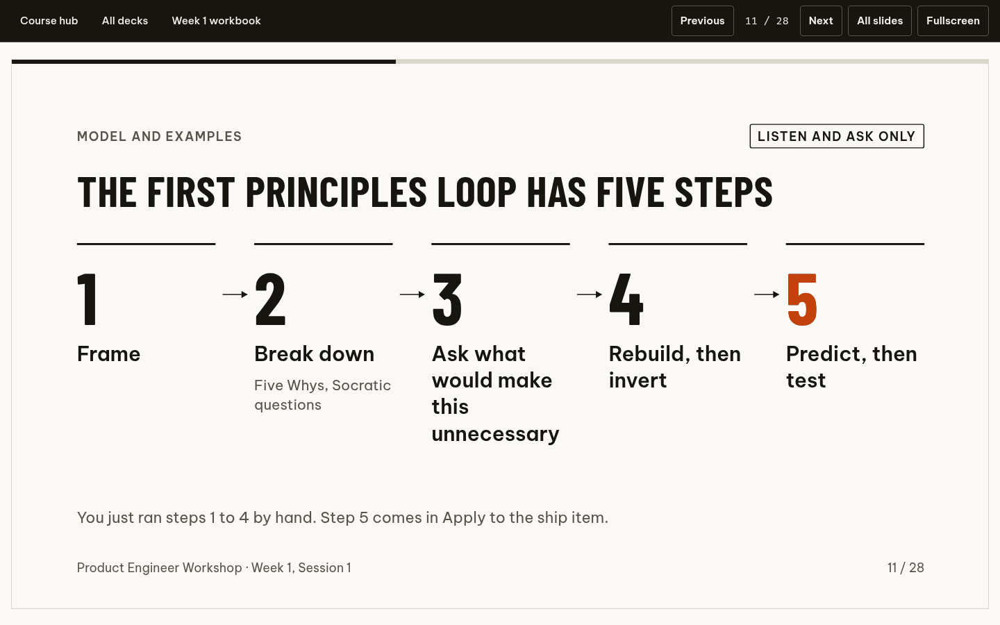

# Product Engineer Workshop

**Language:** English | [Tiếng Việt](README.vi.md)

<p>
<picture>
  <source media="(prefers-color-scheme: dark)" srcset="docs/images/readme/cover-dark.png">
  <source media="(prefers-color-scheme: light)" srcset="docs/images/readme/cover-light.png">
  
</picture>
</p>

A six-week cohort for employed developers, designers and QA. Each learner picks one real item from their current work, ships it, and shows the before-and-after numbers. This repository holds the public learner materials: a course hub, a workbook for Week 0 to Week 6, six Session 1 slide decks (174 slides) and two templates, all as static pages on GitHub Pages.

It is a draft. The course has not been run with learners yet, and the weekly hours and timings are provisional until the first cohort.

FREE + source-available ([PolyForm Shield 1.0.0](LICENSE)).

- Course hub: https://jangtrinh.github.io/product-engineer-workshop/
- Vietnamese portal (Tiếng Việt): https://jangtrinh.github.io/product-engineer-workshop/vi/
- Learner workbook: https://jangtrinh.github.io/product-engineer-workshop/workbook/
- Session 1 slide decks: https://jangtrinh.github.io/product-engineer-workshop/decks/
- Week 0 entry task: https://jangtrinh.github.io/product-engineer-workshop/workbook/week-0.html

<p>
  <a href="#curriculum">Curriculum</a> · <a href="#how-learners-work-each-week">How it works</a> · <a href="#method">Method</a> · <a href="#inside-the-learner-workspace">Workspace</a> · <a href="#preview-locally">Preview locally</a> · <a href="#limits">Limits</a>
</p>

## Curriculum

<p>
<picture>
  <source media="(prefers-color-scheme: dark)" srcset="docs/images/readme/flow-dark.png">
  <source media="(prefers-color-scheme: light)" srcset="docs/images/readme/flow-light.png">
  
</picture>
</p>

Every week moves one real ship item forward by one milestone and adds one layer to your agentic system.

| Week | Topic | Ship item milestone | Agentic system added | Workbook | Slides |
| :--- | :--- | :--- | :--- | :--- | :--- |
| W0 | Before Week 1: entry task | Intake interview preparation, two candidate problems, manager note | None yet | [Week 0](https://jangtrinh.github.io/product-engineer-workshop/workbook/week-0.html) | None |
| W1 | One problem, one number | Problem frame; candidate number | Personal working rules | [Week 1](https://jangtrinh.github.io/product-engineer-workshop/workbook/week-1.html) | [28 slides](https://jangtrinh.github.io/product-engineer-workshop/decks/week-1.html) |
| W2 | Two-way: business and technical | Settle the number, start measuring the baseline window; spec with acceptance criteria | Spec as input for the agent | [Week 2](https://jangtrinh.github.io/product-engineer-workshop/workbook/week-2.html) | [32 slides](https://jangtrinh.github.io/product-engineer-workshop/decks/week-2.html) |
| W3 | What the agent reads | Ontology for the work area; first part of the ship item is built | Ontology, first skill, maker agent | [Week 3](https://jangtrinh.github.io/product-engineer-workshop/workbook/week-3.html) | [32 slides](https://jangtrinh.github.io/product-engineer-workshop/decks/week-3.html) |
| W4 | One-person company (OPC) | First version that passes a grader agent against the acceptance criteria | Three roles: coordinator, maker, grader; self-triggered schedule | [Week 4](https://jangtrinh.github.io/product-engineer-workshop/workbook/week-4.html) | [32 slides](https://jangtrinh.github.io/product-engineer-workshop/decks/week-4.html) |
| W5 | Evidence over assertion | Passes the gate, goes to 1 or 2 colleagues, then ships to real users | Gate that can go red, one routine | [Week 5](https://jangtrinh.github.io/product-engineer-workshop/workbook/week-5.html) | [32 slides](https://jangtrinh.github.io/product-engineer-workshop/decks/week-5.html) |
| W6 | Defence | Ship deadline; oral defence (plus re-measure 2 to 4 weeks later) | Lessons turned into automatic checks | [Week 6](https://jangtrinh.github.io/product-engineer-workshop/workbook/week-6.html) | [18 slides](https://jangtrinh.github.io/product-engineer-workshop/decks/week-6.html) |

Templates:

- [Agent-team kit](https://jangtrinh.github.io/product-engineer-workshop/workbook/agent-team-kit.html): three separate roles (coordinator, maker, grader), a hand-off file format, authority tiers and a planted-defect test. Used from Week 4.
- [Case-study permission letter](https://jangtrinh.github.io/product-engineer-workshop/workbook/case-study-permission.html): asks a manager or legal team for approval to share a sanitised case study. Used in Week 6.

Course facts:

- **For whom:** employed developers, designers and QA with a real product, internal tool or workflow to ship into.
- **Cadence:** 6 study weeks with two live 2-hour sessions each (Session 1 for concepts, Session 2 for peer grading and unblocking) plus provisional self-work, then one re-measure defence 2 to 4 weeks later. At most 5 learners per cohort.
- **AI tools:** any tool your company permits.
- **Data:** workbook inputs are saved in your browser's `localStorage` and each sheet can be copied as Markdown. The pages have no analytics; they load fonts from Google Fonts.

## How learners work each week

1. **Week 0 entry task and manager note.** Prepare two candidate problems from your current work, each with three downward "why" questions (no AI), then send the manager note from the [Week 0 workbook](https://jangtrinh.github.io/product-engineer-workshop/workbook/week-0.html) so your workplace scope is clear before Session 1.
2. **Paper first, then challenge AI drafts.** Session 1 opens with 20 minutes of breaking down and rebuilding on paper without AI. You compare your facts against the model and worked examples, then apply the concept to your ship item.
3. **Measure, build the three-role kit, defend the evidence.** Track baseline and after windows on your ship item, run the [agent-team kit](https://jangtrinh.github.io/product-engineer-workshop/workbook/agent-team-kit.html) from Week 4, and defend raw logs and live checks in Session 2 peer grading and the post-course re-measure.

## Method

The First Principles Loop:

1. **Frame.** State the problem in one sentence, with an observable success test.
2. **Break down.** Ask why repeatedly and use the six types of Socratic question until you reach what cannot be broken down further, keeping certain facts apart from assumptions.
3. **Ask what would make this unnecessary.** If there is an answer, the problem has changed.
4. **Rebuild.** Build the solution only from what is certain, then invert: how could it fail?
5. **Predict, then test.** Write the prediction down before you act, and run the cheapest test that could disprove it.

Four content pillars:

- **Two-way product thinking.** Walk down from a business goal to a technical decision, and back up through measured baseline and after numbers.
- **Ontology engineering.** Define the things, the named relations and the source of truth an agent reads before acting.
- **Management for running agentic AI.** Unit economics, information stewardship, authority tiers and internal control gates, applied to your own workflow.
- **Build your own agentic system.** Working rules, spec, ontology and skill, three-role separation, red-to-green gates and automatic checks, one step at a time.

## Inside the learner workspace

The workbook covers Week 0 to Week 6 with role exercises and copyable Markdown sheets; what you type is saved in the browser as you go.

<p>

</p>

<sub>design:os by Jang</sub>

The six Session 1 decks are 16:9 web pages with keyboard controls (arrows, Page Up and Down, Home, End, G for the slide grid, F for fullscreen) and a print stylesheet for PDF.

<p>

</p>

<sub>design:os by Jang</sub>

The agent-team kit works with any tool: three separate roles, Markdown hand-offs, approval tiers and a planted-defect test. Its page records each dry run and what it changed.

<p>

</p>

<sub>design:os by Jang</sub>

## Preview locally

The site is static HTML, CSS and JavaScript in `docs/`, with no build step:

```bash
python3 -m http.server 4403 --bind 127.0.0.1 --directory docs
```

Then open `http://127.0.0.1:4403/`.

## Limits

- Not yet run with learners. Hours, timings and the agent-team kit (draft version 0.4) will change after the first cohort.
- It does not teach entry-level coding, design or QA craft from scratch.
- It is not a prompt-tips collection or a tour of AI tools.
- It does not teach entrepreneurship, fundraising or starting a company.
- There is no certificate without a shipped change backed by before-and-after numbers.
- Facilitator, grading and contract files are kept out of this repository.

## DESIGN:OS

More from the same author: [Agent Teacher](https://github.com/jangtrinh/design-os-pedagogy), [Orchestration System by Jang](https://github.com/jangtrinh/orchestration-system-by-jang), [Knowledge Builder](https://github.com/jangtrinh/design-os-knowledge-builder) and [Studio](https://github.com/jangtrinh/design-os-studio). More on [jangtrinh.github.io](https://jangtrinh.github.io/).

## License

- [PolyForm Shield 1.0.0](LICENSE). FREE to use and modify, including for paid client work; you may not resell it or build a competing product from it.

If `product-engineer-workshop` saves you time, a star on GitHub helps other engineers and AI agents find it.

<p align="left">
  <a href="https://buymeacoffee.com/jangtrinh">
    
  </a>
</p>

Built by [Jang Trịnh](https://github.com/jangtrinh), creative technologist and autonomous system architect.

[GitHub](https://github.com/jangtrinh) · [LinkedIn](https://www.linkedin.com/in/jangtrinh/) · [Hub](https://jangtrinh.github.io/) · [YouTube](https://www.youtube.com/@designosbyjang) · [X](https://x.com/Jangtrinhvn)
