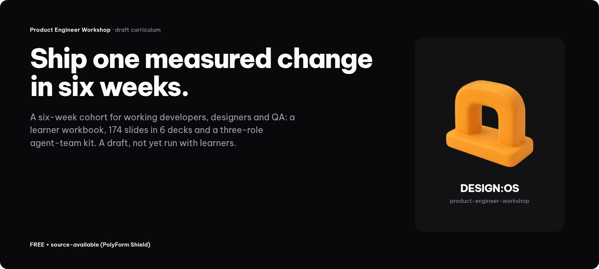
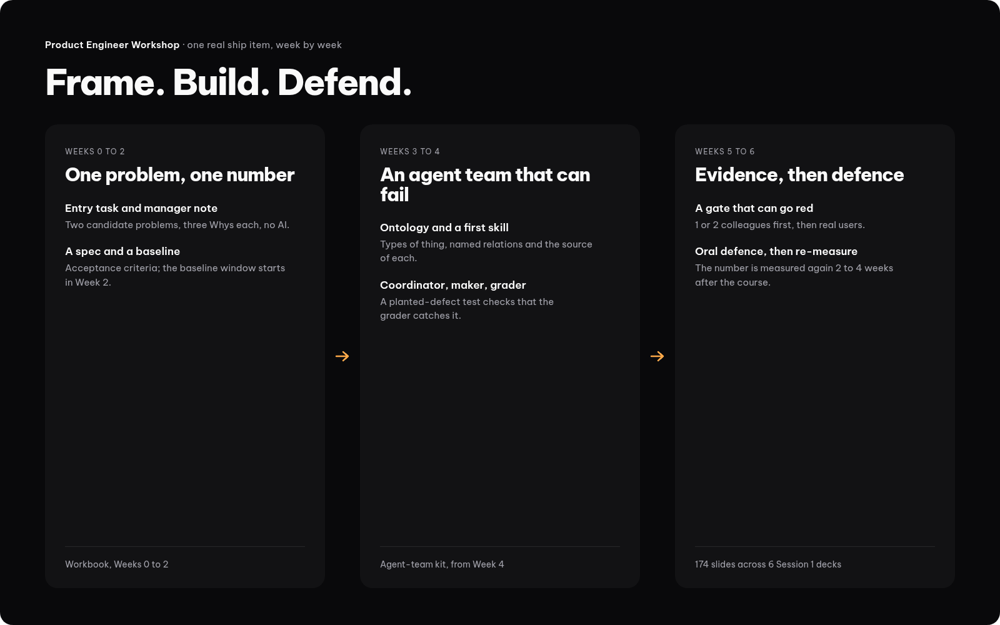
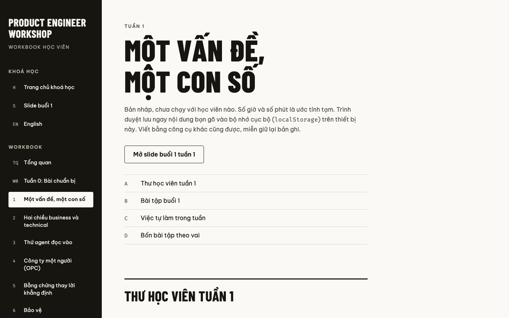
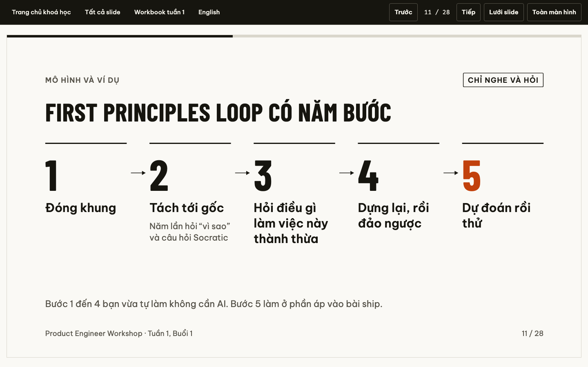
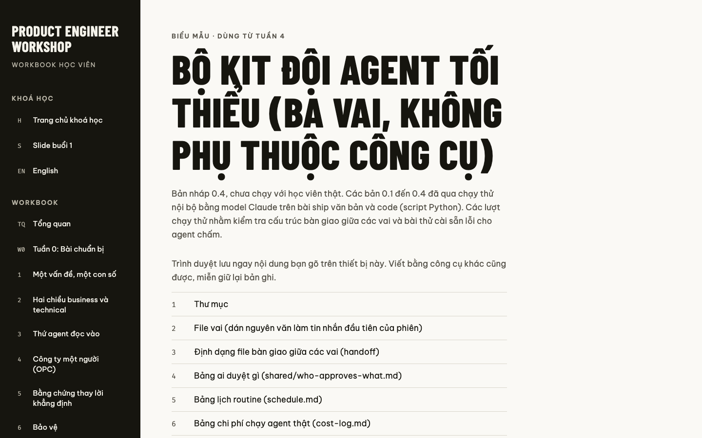

# Product Engineer Workshop

**Ngôn ngữ:** [English](README.md) | Tiếng Việt

<p>
<picture>
  <source media="(prefers-color-scheme: dark)" srcset="docs/images/readme/cover-dark.png">
  <source media="(prefers-color-scheme: light)" srcset="docs/images/readme/cover-light.png">
  
</picture>
</p>

Khoá học sáu tuần dành cho developer, designer và QA đang đi làm. Mỗi học viên chọn một việc thật ở công ty, tự tay ship (đưa vào sử dụng thật) thay đổi đó rồi báo cáo số đo trước sau. Kho mã này chứa phần học liệu công khai chạy bằng HTML tĩnh trên GitHub Pages. Bên trong gồm trang chủ khoá học, workbook từ tuần 0 đến tuần 6, hai biểu mẫu và sáu bộ slide buổi 1 (174 trang).

Đây là bản nháp. Khoá học chưa chạy với học viên nào, nên số giờ tự học mới là ước tính tạm cho tới sau lớp (cohort) đầu tiên.

MIỄN PHÍ + source-available ([PolyForm Shield 1.0.0](LICENSE)).

- Trang chủ khoá học (bản tiếng Việt): https://jangtrinh.github.io/product-engineer-workshop/vi/
- Trang chủ bản tiếng Anh: https://jangtrinh.github.io/product-engineer-workshop/
- Workbook học viên: https://jangtrinh.github.io/product-engineer-workshop/vi/workbook/
- Sáu bộ slide buổi 1: https://jangtrinh.github.io/product-engineer-workshop/vi/decks/
- Bài chuẩn bị tuần 0: https://jangtrinh.github.io/product-engineer-workshop/vi/workbook/week-0.html

<p>
  <a href="#chương-trình-học">Chương trình học</a> · <a href="#cách-học-trong-mỗi-tuần">Cách học</a> · <a href="#phương-pháp">Phương pháp</a> · <a href="#bên-trong-không-gian-học-tập">Không gian học tập</a> · <a href="#chạy-thử-trên-máy">Chạy thử</a> · <a href="#giới-hạn-của-khoá-học">Giới hạn</a>
</p>

## Chương trình học

<p>
<picture>
  <source media="(prefers-color-scheme: dark)" srcset="docs/images/readme/flow-dark.png">
  <source media="(prefers-color-scheme: light)" srcset="docs/images/readme/flow-light.png">
  
</picture>
</p>

Mỗi tuần bài ship tiến thêm một cột mốc, còn học viên lắp thêm một lớp mới cho hệ agent (chương trình AI tự chạy nhiều bước).

| Tuần | Chủ đề | Cột mốc bài ship | Lớp agent lắp thêm | Workbook | Slide |
| :--- | :--- | :--- | :--- | :--- | :--- |
| W0 | Tuần 0: Bài chuẩn bị | Chuẩn bị phỏng vấn đầu vào, hai vấn đề dự kiến và thư gửi quản lý | Chưa có | [Tuần 0](https://jangtrinh.github.io/product-engineer-workshop/vi/workbook/week-0.html) | Không có |
| W1 | Một vấn đề, một con số | Khung vấn đề một câu và con số dự kiến | Bộ rule làm việc cá nhân (working rules) | [Tuần 1](https://jangtrinh.github.io/product-engineer-workshop/vi/workbook/week-1.html) | [28 trang](https://jangtrinh.github.io/product-engineer-workshop/vi/decks/week-1.html) |
| W2 | Hai chiều business và technical | Chốt con số, mở giai đoạn đo trước khi sửa (baseline) và viết spec (bản mô tả kèm tiêu chí nghiệm thu) | Bản spec làm đầu vào cho agent | [Tuần 2](https://jangtrinh.github.io/product-engineer-workshop/vi/workbook/week-2.html) | [32 trang](https://jangtrinh.github.io/product-engineer-workshop/vi/decks/week-2.html) |
| W3 | Thứ agent đọc vào | Dựng ontology (bản đồ sự vật, quan hệ và nguồn) cho vùng việc, rồi build phần đầu bài ship | Ontology, skill đầu tiên và agent thực thi (Maker) | [Tuần 3](https://jangtrinh.github.io/product-engineer-workshop/vi/workbook/week-3.html) | [32 trang](https://jangtrinh.github.io/product-engineer-workshop/vi/decks/week-3.html) |
| W4 | Công ty một người (OPC) | Bản đầu tiên qua được agent chấm theo tiêu chí nghiệm thu | Đội ba vai điều phối, thực thi, chấm bài (Coordinator, Maker, Grader) và lịch chạy định kỳ | [Tuần 4](https://jangtrinh.github.io/product-engineer-workshop/vi/workbook/week-4.html) | [32 trang](https://jangtrinh.github.io/product-engineer-workshop/vi/decks/week-4.html) |
| W5 | Bằng chứng thay lời khẳng định | Qua gate (cổng kiểm tự động), đưa 1 đến 2 đồng nghiệp dùng thử rồi ship cho người dùng thật | Gate biết báo đỏ và một routine lặp lại theo lịch | [Tuần 5](https://jangtrinh.github.io/product-engineer-workshop/vi/workbook/week-5.html) | [32 trang](https://jangtrinh.github.io/product-engineer-workshop/vi/decks/week-5.html) |
| W6 | Bảo vệ | Chốt hạn ship cuối, bảo vệ bằng lời và đo lại sau 2 đến 4 tuần | Chuyển bài học từ các lỗi gặp phải thành phép kiểm tự động | [Tuần 6](https://jangtrinh.github.io/product-engineer-workshop/vi/workbook/week-6.html) | [18 trang](https://jangtrinh.github.io/product-engineer-workshop/vi/decks/week-6.html) |

Hai biểu mẫu dùng chung trong khoá học:

- [Bộ kit đội agent](https://jangtrinh.github.io/product-engineer-workshop/vi/workbook/agent-team-kit.html): mẫu tách ba vai Coordinator, Maker và Grader qua file Markdown. Kèm bảng phân quyền và bài thử cài sẵn lỗi, dùng từ tuần 4.
- [Mẫu thư xin phép chia sẻ công khai](https://jangtrinh.github.io/product-engineer-workshop/vi/workbook/case-study-permission.html): mẫu thư gửi quản lý xin đăng ca làm thực tế (case study) đã xoá dữ liệu nội bộ. Dùng ở tuần 6.

Thông tin chính của khoá học:

- **Đối tượng học:** dành cho developer, designer và QA. Học viên đang trực tiếp làm sản phẩm, công cụ nội bộ hay quy trình thật, và có quyền đưa thay đổi vào sử dụng.
- **Lịch học:** 6 tuần học, mỗi tuần gồm hai buổi trực tiếp 2 giờ (khái niệm và chấm chéo) kèm giờ tự làm. Sau khi hết tuần 6 khoảng 2 đến 4 tuần, lớp họp buổi bảo vệ số liệu đo lại. Tối đa 5 người mỗi lớp.
- **Công cụ AI:** dùng bất kỳ công cụ nào công ty cho phép.
- **Dữ liệu:** bài làm trong workbook lưu ở bộ nhớ cục bộ (`localStorage`) trên trình duyệt và chép được ra Markdown. Trang web không đặt mã theo dõi, nhưng có tải font từ Google Fonts.

## Cách học trong mỗi tuần

1. **Làm bài chuẩn bị tuần 0 và gửi thư cho quản lý**. Chọn hai vấn đề dự kiến từ công việc, tự hỏi ba lần “vì sao” theo chiều nguyên nhân trên giấy và không dùng AI. Sau đó gửi mẫu thư trong [workbook tuần 0](https://jangtrinh.github.io/product-engineer-workshop/vi/workbook/week-0.html) để chốt phạm vi làm bài trước buổi 1.
2. **Viết trên giấy trước, rồi mới phản biện bản nháp của AI**. Buổi 1 mở đầu bằng 20 phút tự tách vấn đề và dựng lại lời giải trên giấy, không dùng AI. Học viên đối chiếu phần mình viết với mô hình mẫu và ví dụ rồi áp vào bài ship.
3. **Đo số liệu, dựng đội ba vai và bảo vệ bằng log thật**. Theo dõi giai đoạn đo trước khi sửa (baseline) và giai đoạn đo sau khi ship trên thay đổi đang làm. Từ tuần 4, chạy [bộ kit đội agent](https://jangtrinh.github.io/product-engineer-workshop/vi/workbook/agent-team-kit.html) rồi mang log thật cùng phép kiểm trực tiếp ra buổi chấm chéo và buổi đo lại.

## Phương pháp

Năm bước của First Principles Loop:

1. **Đóng khung**. Phát biểu vấn đề gọn một câu, kèm phép thử thành công quan sát được.
2. **Tách tới gốc**. Hỏi “vì sao” liên tiếp bằng sáu nhóm câu hỏi Socratic tới khi không tách nhỏ thêm được. Tách rạch ròi điều chắc chắn khỏi giả định.
3. **Hỏi điều gì làm việc này thành thừa**. Nếu có câu trả lời, bài toán ban đầu đã đổi.
4. **Dựng lại**. Chỉ dựng giải pháp từ những điều chắc chắn, rồi nghĩ ngược lại xem giải pháp có thể hỏng ở đâu.
5. **Dự đoán rồi thử**. Viết dự đoán ra trước khi làm, rồi chạy một phép thử ít tốn công để kiểm xem dự đoán đó có sai không.

Bốn trụ cột nội dung:

- **Tư duy sản phẩm hai chiều**. Đi từ mục tiêu kinh doanh xuống quyết định kỹ thuật, rồi đi ngược lên bằng số đo trước và sau khi sửa.
- **Kỹ thuật dựng ontology**. Xác định các loại sự vật, quan hệ có tên và một nơi gốc chuẩn (single source of truth) để agent đọc trước khi chạy.
- **Quản trị khi vận hành agentic AI**. Áp dụng kinh tế đơn vị (giá trị và chi phí mỗi đơn vị), giữ quyền sở hữu dữ liệu, phân quyền và đặt gate kiểm soát.
- **Tự dựng hệ thống agent riêng**. Lắp dần bộ rule làm việc, spec, ontology cùng skill, đội ba vai, gate biết báo đỏ và phép kiểm tự động.

## Bên trong không gian học tập

Workbook phủ từ tuần 0 đến tuần 6 với bài tập theo từng vai và các phiếu chép nhanh sang Markdown. Dữ liệu gõ vào tự lưu ngay vào bộ nhớ cục bộ trên trình duyệt.

<p>

</p>

<sub>design:os by Jang</sub>

Sáu bộ slide buổi 1 chạy trên web theo tỷ lệ 16:9 và có bản in PDF. Người xem dùng phím mũi tên, Page Up/Down, Home, End, phím G mở lưới slide và phím F toàn màn hình. Ở slide 11 tuần 1, người học tự viết bốn bước đầu trên giấy rồi nối bước 5 thẳng sang bài ship.

<p>

</p>

<sub>design:os by Jang</sub>

Bộ kit đội agent chạy trên mọi công cụ với ba vai tách riêng, file Markdown, bảng ai duyệt gì và bài thử cài sẵn lỗi. Trang này cũng ghi lại từng lượt chạy thử và những điểm đã sửa.

<p>

</p>

<sub>design:os by Jang</sub>

## Chạy thử trên máy

Toàn bộ trang web dùng HTML, CSS và JavaScript tĩnh trong thư mục `docs/`, không cần bước build:

```bash
python3 -m http.server 4403 --bind 127.0.0.1 --directory docs
```

Sau đó mở địa chỉ `http://127.0.0.1:4403/vi/` trên trình duyệt.

## Giới hạn của khoá học

- Khoá học chưa chạy với học viên thật. Thời lượng tự học và bộ kit đội agent (bản nháp 0.4) sẽ được chỉnh lại sau lớp (cohort) đầu tiên.
- Không dạy lập trình, thiết kế hay QA căn bản cho người mới bắt đầu.
- Không phải bộ sưu tập mẹo viết prompt hay buổi điểm danh các công cụ AI.
- Không dạy khởi nghiệp, gọi vốn hay cách lập công ty mới.
- Không cấp chứng chỉ nếu thiếu một thay đổi đã ship kèm số đo trước và sau.
- Các file dành cho người phụ trách lớp, phần chấm điểm và cam kết học tập không đưa vào kho mã công khai này.

## DESIGN:OS

Các dự án khác cùng tác giả: [Agent Teacher][dos-pedagogy], [Orchestration System by Jang][dos-orch], [Knowledge Builder][dos-kb] và [Studio][dos-studio]. Xem thêm ở [jangtrinh.github.io][dos-hub].

[dos-pedagogy]: https://github.com/jangtrinh/design-os-pedagogy
[dos-orch]: https://github.com/jangtrinh/orchestration-system-by-jang
[dos-kb]: https://github.com/jangtrinh/design-os-knowledge-builder
[dos-studio]: https://github.com/jangtrinh/design-os-studio
[dos-hub]: https://jangtrinh.github.io/

## Giấy phép

- [PolyForm Shield 1.0.0](LICENSE). Miễn phí dùng và chỉnh sửa, kể cả trong dự án làm cho khách hàng. Không được bán lại hoặc dựng sản phẩm cạnh tranh từ tài liệu này.

Nếu `product-engineer-workshop` giúp ích cho công việc, bạn có thể nhấn Star trên GitHub để nhiều người khác tìm thấy kho mã này.

<p align="left">
  <a href="https://buymeacoffee.com/jangtrinh">
    
  </a>
</p>

Tác giả là [Jang Trịnh](https://github.com/jangtrinh), kỹ sư công nghệ sáng tạo và kiến trúc sư hệ thống tự vận hành.

[GitHub][my-gh] · [LinkedIn][my-li] · [Hub][dos-hub] · [YouTube][my-yt] · [X][my-x]

[my-gh]: https://github.com/jangtrinh
[my-li]: https://www.linkedin.com/in/jangtrinh/
[my-yt]: https://www.youtube.com/@designosbyjang
[my-x]: https://x.com/Jangtrinhvn
